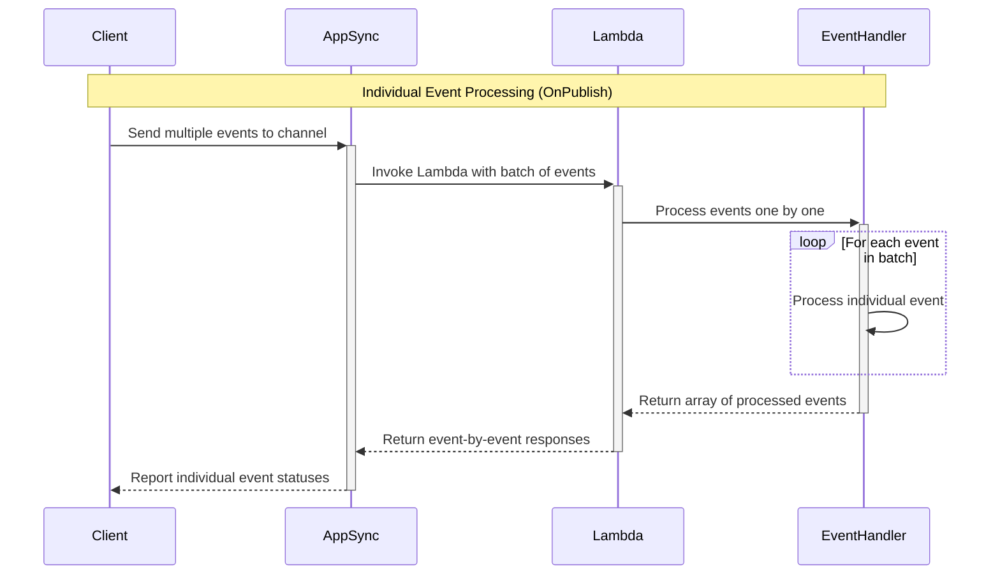
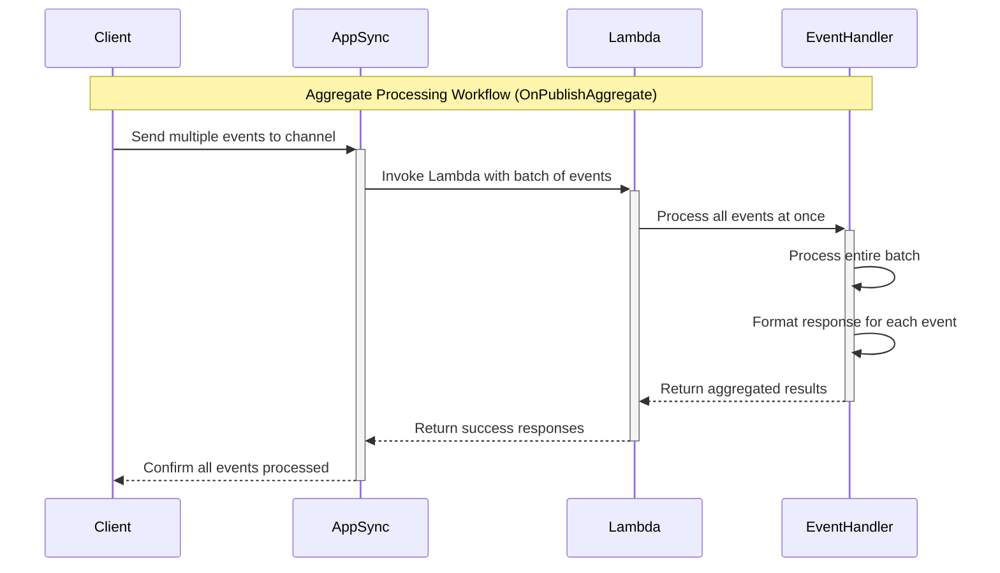
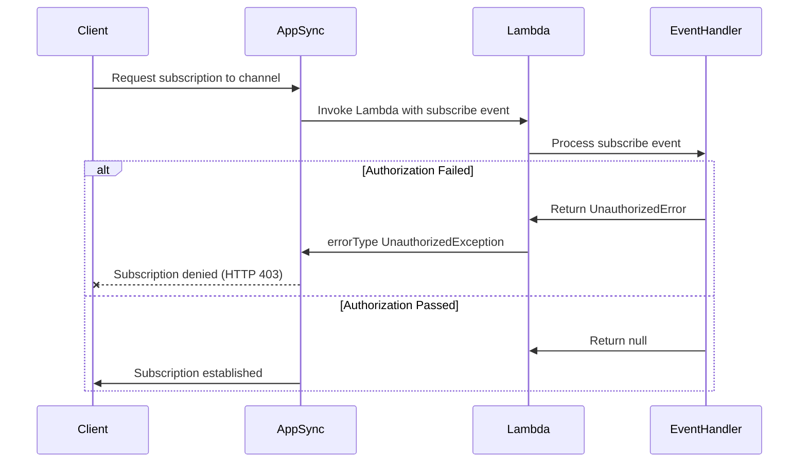

# AppSync Events

The `appsyncevents` package handles the publish and subscribe operations of
AWS AppSync Events channel namespaces whose handler is a Lambda function.

```go
import "github.com/alessandrolattao/powertools-lambda-go/eventhandler/appsyncevents"
```

## Key features

- Publish and subscribe handlers registered per channel path
- Wildcard paths for catch-all handlers, the most specific path winning
- Payloads decoded into Go types, results encoded as JSON
- Aggregate processing of all the events of a request at once
- Errors per event, for the whole request, and authorization failures with
  the `errorType` AppSync Events expects
- Bounded concurrent processing of the events of a request

## Terminology

**[AWS AppSync Events](https://docs.aws.amazon.com/appsync/latest/eventapi/event-api-welcome.html)**:
a service to build secure, scalable real-time WebSocket APIs without managing
infrastructure. It handles connections, broadcasting, authentication and
monitoring. A channel namespace can invoke a Lambda function for the publish
and subscribe operations on its channels.

## Getting started

### Required resources

An AppSync Events API with a channel namespace whose handler is the Lambda
function, and the permission for AppSync to invoke it. Routing needs nothing
else.

### AppSync request and response format

AppSync Events invokes the function with the operation (`PUBLISH` or
`SUBSCRIBE`), the channel, the identity of the caller, the request headers
and, for a publish, the events:

```json
{
  "identity": null,
  "request": {
    "headers": {"x-forwarded-for": "1.1.1.1, 2.2.2.2"},
    "domainName": null
  },
  "info": {
    "channel": {"path": "/default/channel", "segments": ["default", "channel"]},
    "channelNamespace": {"name": "default"},
    "operation": "PUBLISH"
  },
  "events": [
    {"id": "1", "payload": {"data": "data_1"}},
    {"id": "2", "payload": {"data": "data_2"}}
  ]
}
```

A publish answers the events to broadcast, each with the `id` it came with:

```json
{"events": [{"id": "1", "payload": {"data": "data_1"}}, {"id": "2", "payload": {"data": "data_2"}}]}
```

#### Events response with error

There are three ways to report an error to AppSync, and the package builds
each from what the handlers return:

- **An error for one event**: the event carries an `error` instead of a
  `payload`, and is not broadcast:
  `{"events": [{"id": "1", "error": "Error message"}, {"id": "2", "payload": {"data": "data_2"}}]}`
- **The whole request fails**: a top-level `error`:
  `{"error": "Exception - An exception occurred"}`
- **Unauthorized**: the invocation fails with the `errorType`
  `UnauthorizedException`, which rejects a subscribe with HTTP 403 and
  broadcasts nothing of a publish.

### Handler functions

`appsyncevents.OnPublish` registers a function for the publish operations on
the channels of a path. It is called once per event, with its payload
decoded into the function's payload type; what it returns, encoded as JSON,
is what the subscribers receive. `Router.OnSubscribe` registers a function
for the subscribe operations: returning `nil` accepts the subscription.
`Router.Resolve` is the Lambda handler.

```go
package main

import (
	"context"

	"github.com/aws/aws-lambda-go/lambda"

	"github.com/alessandrolattao/powertools-lambda-go/eventhandler/appsyncevents"
)

type Message struct {
	Data string `json:"data"`
}

type Processed struct {
	Processed       bool    `json:"processed"`
	OriginalPayload Message `json:"original_payload"`
}

func main() {
	app := appsyncevents.New()
	appsyncevents.OnPublish(app, "/default/channel", func(ctx context.Context, payload Message) (Processed, error) {
		return Processed{Processed: true, OriginalPayload: payload}, nil
	})
	app.OnSubscribe("/*", func(ctx context.Context) error {
		event, _ := appsyncevents.CurrentEvent(ctx)
		if !isAuthorized(event.Info.Channel.Path) {
			return &appsyncevents.UnauthorizedError{Message: "You are not authorized to subscribe to this channel"}
		}
		return nil
	})
	lambda.Start(app.Resolve)
}

func isAuthorized(path string) bool {
	return path != "/default/not_allowed"
}
```

`appsyncevents.DefaultPath` is `/default/*`, every channel of the default
namespace.

## Advanced

### Wildcard patterns and handler precedence

A path is an exact channel (`/default/channel1`), a wildcard over a namespace
or a subtree (`/default/*`, `/default/v1/*`), or every channel (`/*`). When
several match an event, the most specific wins: an exact path over any
wildcard, a longer wildcard over a shorter one. `/default/channel1` takes
precedence over `/default/*`, which takes precedence over `/*`.

```go
appsyncevents.OnPublish(app, "/default/channel1", func(ctx context.Context, payload Message) (Routed, error) {
	return Routed{Source: "specific_handler", Data: payload}, nil
})
appsyncevents.OnPublish(app, "/default/*", func(ctx context.Context, payload Message) (Routed, error) {
	// every channel of the default namespace but /default/channel1
	return Routed{Source: "namespace_handler", Data: payload}, nil
})
appsyncevents.OnPublish(app, "/*", func(ctx context.Context, payload Message) (Routed, error) {
	// every other channel of every namespace
	return Routed{Source: "catch_all_handler", Data: payload}, nil
})
```

A wildcard is allowed only as the last segment: `/default/channel*` and
`/default/*/subpath` are not valid, and registering them panics when the
function starts, as does registering two handlers for the same path and
operation.

A publish to a channel without a handler logs a warning (once per channel) to
standard error and returns the events as they came, so they are broadcast
unchanged. A subscribe without a handler logs a warning and is accepted.
`appsyncevents.New(appsyncevents.WithLogger(logger))` sends the warnings to a
logger of your own.

### Aggregated processing

`appsyncevents.OnPublishAggregate` hands the function all the events of the
request at once, to write them with one batch operation, process them all or
none, or handle errors in one place. It returns a `Result` per event to
broadcast; an event left out, or a `Result` with an `Error`, is not
broadcast.

```go
appsyncevents.OnPublishAggregate(app, "/default/foo/*", func(ctx context.Context, events []appsyncevents.Event[Message]) ([]appsyncevents.Result[Message], error) {
	items := make([]Message, len(events))
	for i, event := range events {
		items[i] = event.Payload
	}
	if err := saveAll(ctx, items); err != nil { // one batch write
		return nil, err
	}
	results := make([]appsyncevents.Result[Message], len(events))
	for i, event := range events {
		results[i] = appsyncevents.Result[Message]{ID: event.ID, Payload: event.Payload}
	}
	return results, nil
})
```

### Handling errors

Rejecting an event, by returning an error or a `Result` with an `Error`,
tells AppSync not to broadcast it.

#### Handling errors with individual items

With `OnPublish`, an error fails its event only: the response carries
`"<type> - <message>"` for it, where the type is the name of the error's Go
type, and the other events go on. A payload that does not decode into the
payload type fails its event the same way (`PayloadError - ...`).

```go
type ValidationError struct{ Message string }

func (e *ValidationError) Error() string { return e.Message }

appsyncevents.OnPublish(app, "/default/channel", func(ctx context.Context, payload Message) (map[string]string, error) {
	if payload.Data == "" {
		return nil, &ValidationError{Message: "Invalid payload format"}
	}
	return map[string]string{"processed": payload.Data}, nil
})
```

```json
{"events": [{"id": "1", "error": "ValidationError - Invalid payload format"}, {"id": "2", "payload": {"processed": "data_2"}}]}
```

#### Handling errors with batch of items

With `OnPublishAggregate`, set the `Error` of the events to reject:

```go
appsyncevents.OnPublishAggregate(app, "/default/*", func(ctx context.Context, events []appsyncevents.Event[Message]) ([]appsyncevents.Result[Message], error) {
	results := make([]appsyncevents.Result[Message], 0, len(events))
	for _, event := range events {
		if event.Payload.Data == "" {
			results = append(results, appsyncevents.Result[Message]{ID: event.ID, Error: "Error message"})
			continue
		}
		results = append(results, appsyncevents.Result[Message]{ID: event.ID, Payload: event.Payload})
	}
	return results, nil
})
```

To fail the entire request instead, return an error: AppSync receives a
top-level `error`.

```go
type ChannelError struct{}

func (ChannelError) Error() string { return "An exception occurred" }

appsyncevents.OnPublishAggregate(app, "/default/*", func(ctx context.Context, events []appsyncevents.Event[Message]) ([]appsyncevents.Result[Message], error) {
	return nil, ChannelError{}
})
```

```json
{"error": "ChannelError - An exception occurred"}
```

#### Authorization control

!!! warning
    An `*appsyncevents.UnauthorizedError` fails the Lambda invocation.

Return an `*appsyncevents.UnauthorizedError` (or an error wrapping one) to
authorize channels by content:

- **from a publish handler**, nothing of the request is broadcast; with
  `OnPublish`, the events not handled yet are skipped;
- **from a subscribe handler**, the subscription is refused with HTTP 403.

```go
appsyncevents.OnPublish(app, "/default/foo", func(ctx context.Context, payload Message) (Message, error) {
	return payload, nil
})
appsyncevents.OnPublish(app, "/*", func(ctx context.Context, payload Message) (Message, error) {
	return Message{}, &appsyncevents.UnauthorizedError{Message: "You can only publish to /default/foo"}
})
app.OnSubscribe("/default/foo", func(ctx context.Context) error { return nil })
app.OnSubscribe("/*", func(ctx context.Context) error {
	return &appsyncevents.UnauthorizedError{Message: "You can only subscribe to /default/foo"}
})
```

`Resolve` turns it into a `messages.InvokeResponse_Error` (from
`github.com/aws/aws-lambda-go/lambda/messages`) whose `Type` is
`UnauthorizedException`, which aws-lambda-go reports as it is: the Go type's
name would not be the `errorType` AppSync Events looks for. A middleware
around `Resolve` must return that error unwrapped.

### Processing events concurrently

`WithConcurrency(n)` makes `OnPublish` handle up to `n` events of the request
at the same time, each in its own goroutine, as Powertools Python's
`async_on_publish` gathers them. The response keeps the order of the events,
although AppSync matches results and events by `id` anyway.

```go
appsyncevents.OnPublish(app, "/default/*", func(ctx context.Context, payload Message) (Message, error) {
	return enrich(ctx, payload) // a call to another service
}, appsyncevents.WithConcurrency(5))
```

### Accessing Lambda context and event

`appsyncevents.CurrentEvent` returns the invocation event from the context
the handler receives: identity, request headers, channel and namespace,
operation and events. `lambdacontext.FromContext(ctx)` returns the Lambda
context.

```go
appsyncevents.OnPublish(app, "/default/channel1", func(ctx context.Context, payload Message) (map[string]any, error) {
	event, _ := appsyncevents.CurrentEvent(ctx)
	lc, _ := lambdacontext.FromContext(ctx)
	return map[string]any{
		"originalMessage": payload,
		"userAgent":       event.Request.Headers["user-agent"],
		"requestId":       lc.AwsRequestID,
	}, nil
})
```

Data the handler shares with every handler (Powertools Python's
`append_context`) goes in the context before `Resolve` runs, by the Lambda
handler or by a middleware.

### Split handlers with Router

Handlers can be registered on routers of their own and included in the
application with `Include`:

```go
chat := appsyncevents.New()
appsyncevents.OnPublish(chat, "/chat/*", handleChatMessage)

app := appsyncevents.New()
app.Include(chat)
```

## Event Handler workflow

### Working with single items



### Working with aggregated items



### Authorization fails for subscribe



## Testing your code

There are no external calls: build an event, or load a sample one, and call
`Resolve`.

### Testing publish events

```go
func TestPublish(t *testing.T) {
	app := appsyncevents.New()
	appsyncevents.OnPublish(app, "/default/*", func(ctx context.Context, payload Message) (map[string]any, error) {
		return map[string]any{"processed": true, "data": payload.Data}, nil
	})
	event := jsontext.Value(`{
		"info": {"operation": "PUBLISH", "channel": {"path": "/default/channel"}},
		"events": [{"id": "123", "payload": {"data": "test data"}}]
	}`)
	out, err := app.Resolve(t.Context(), event)
	require.NoError(t, err)
	assert.JSONEq(t, `{"events":[{"id":"123","payload":{"processed":true,"data":"test data"}}]}`, string(out))
}
```

### Testing subscribe events

```go
func TestSubscribe(t *testing.T) {
	app := appsyncevents.New()
	app.OnSubscribe("/*", func(ctx context.Context) error {
		return &appsyncevents.UnauthorizedError{Message: "denied"}
	})
	event := jsontext.Value(`{"info": {"operation": "SUBSCRIBE", "channel": {"path": "/default/channel"}}}`)
	_, err := app.Resolve(t.Context(), event)
	assert.Equal(t, messages.InvokeResponse_Error{Type: "UnauthorizedException", Message: "denied"}, err)
}
```

## Differences from Powertools Python

- Payloads are decoded into the handler's type and results encoded with
  `encoding/json/v2`; aggregate handlers return typed `Result` values, so the
  non-list response Python warns about cannot happen.
- An `UnauthorizedError` from a per-event publish handler fails the
  invocation, as the Powertools Python documentation says; its code reports
  it as an error of that event instead.
- A wildcard matches at a segment boundary: `/default/*` does not match
  `/defaults/a`, which Python's regular expression does. An exact path wins
  over a wildcard ending at the same place (`/a/b` over `/a/b/*` for the
  channel `/a/b`), where Python's score prefers the wildcard.
- No async handlers, so no precedence of a sync handler over an async one
  (Python consults the two registries separately, so a sync `/*` beats an
  async `/default/foo`): one handler per path and operation, with
  `WithConcurrency` for concurrent events.
- An invalid path panics at registration (Python warns and skips the
  handler), and so does a second handler for the same path and operation,
  directly or through `Include` (Python lets the last one win).
- A publish without events gives an aggregate handler no events (Python
  gives it one empty placeholder event).
- `current_event`, `lambda_context` and the context dictionary are context
  values, safe under concurrent invocations (Lambda Managed Instances), with
  nothing to clear.
