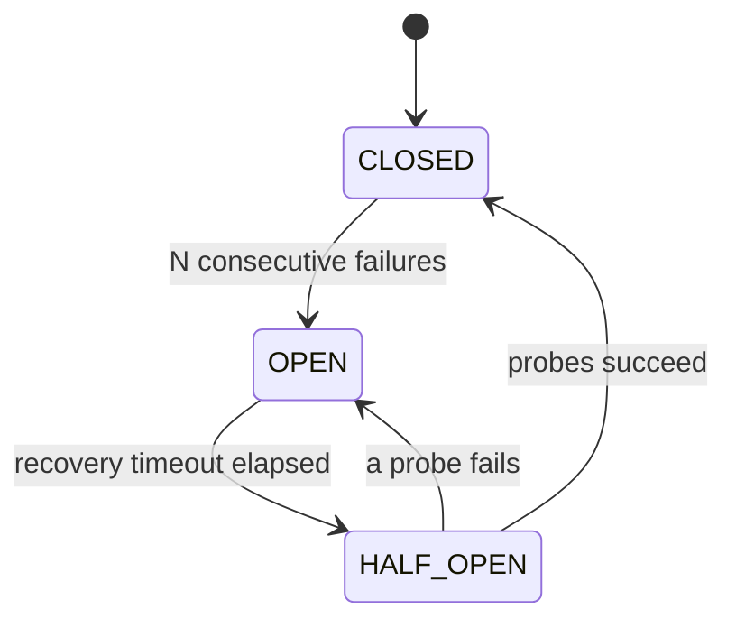

# Circuit breaker

The `circuitbreaker` package stops sending traffic to an unhealthy downstream
dependency, giving it room to recover while you decide what happens to the
rejected requests.

```go
import "github.com/alessandrolattao/powertools-lambda-go/circuitbreaker"
```

## Key features

- Stops calling an unhealthy downstream after a configurable number of
  consecutive failures
- Hands rejected requests to a callback, so that you decide what happens next
  (buffer, drop, return a cached value), or returns an error you can inspect
- Tests recovery with an explicit half-open probe instead of retrying
  everything at once
- Shares circuit state across execution environments through Amazon DynamoDB,
  in the same format as Powertools for AWS Lambda (Python)
- Safe under concurrency: one half-open probe across all goroutines and
  execution environments, and synchronized failure counting
- Keeps the healthy path write-free: failures are counted in memory and
  written only on a state transition

## Terminology

**Circuit** is a named guard around a single downstream dependency. Each name
is an independent circuit.

**State** is the circuit's current mode: `CLOSED` (healthy), `OPEN` (the
downstream is considered unhealthy, calls are skipped) or `HALF_OPEN` (recovery
is being tested).

**Store** is the shared storage that holds the state of each circuit, so that
every execution environment agrees on whether a circuit is open.

**Recovery timeout** is how long a circuit stays open before a half-open probe.



## Getting started

### IAM permissions

| IAM permission        | Operation                                           |
| --------------------- | --------------------------------------------------- |
| `dynamodb:GetItem`    | Read the shared circuit state                       |
| `dynamodb:PutItem`    | Persist an opened circuit and elect the probe       |
| `dynamodb:UpdateItem` | Close or reopen a circuit after a probe             |

### DynamoDB table

| Configuration      | Value        | Notes                  |
| ------------------ | ------------ | ---------------------- |
| Partition key      | `id`         | Holds the circuit name |
| TTL attribute name | `expiration` |                        |

One table can hold all your circuits. In AWS SAM:

```yaml
CircuitBreakerTable:
  Type: AWS::DynamoDB::Table
  Properties:
    AttributeDefinitions:
      - AttributeName: id
        AttributeType: S
    KeySchema:
      - AttributeName: id
        KeyType: HASH
    TimeToLiveSpecification:
      AttributeName: expiration
      Enabled: true
    BillingMode: PAY_PER_REQUEST
```

### Circuit breaker in action

Create the breaker once, in `main`, and guard the function that calls the
downstream. With no options, the defaults apply: open after 5 consecutive
failures, probe after 30 seconds, close after 3 successful probes, count every
error as a failure.

```go
type Order struct{ ID string }

// paymentAPI is the client of the payment backend.
type paymentAPI struct{ baseURL string }

func (p paymentAPI) Charge(ctx context.Context, orderID string) (string, error) {
	req, err := http.NewRequestWithContext(ctx, http.MethodPost, p.baseURL+"/charges/"+orderID, http.NoBody)
	if err != nil {
		return "", err
	}
	resp, err := http.DefaultClient.Do(req)
	if err != nil {
		return "", err
	}
	defer resp.Body.Close()
	if resp.StatusCode >= http.StatusInternalServerError {
		return "", fmt.Errorf("payment backend: %s", resp.Status)
	}
	return resp.Header.Get("Receipt-Id"), nil
}

func main() {
	ctx := context.Background()
	cfg, err := config.LoadDefaultConfig(ctx)
	if err != nil {
		panic(err)
	}
	store, err := circuitbreaker.NewDynamoDBStoreFromConfig(cfg, os.Getenv("CIRCUIT_BREAKER_TABLE"))
	if err != nil {
		panic(err)
	}
	payments, err := circuitbreaker.New("payment-backend", store)
	if err != nil {
		panic(err)
	}

	api := paymentAPI{baseURL: os.Getenv("PAYMENTS_URL")}
	charge := func(ctx context.Context, order Order) (string, error) {
		return api.Charge(ctx, order.ID) // the protected downstream call
	}
	// Circuit closed: charge runs and returns the backend response.
	// Circuit open: charge is skipped and an *OpenError is returned.
	lambda.Start(payments.Wrap(charge))
}
```

`Wrap` returns a function with the signature of the one it guards. `Call` runs
a single call through the circuit:

```go
receipt, err := payments.Call(ctx, func(ctx context.Context) (string, error) {
	return api.Charge(ctx, order.ID)
})
```

!!! note "Guard the downstream call, not the whole handler"
    The circuit protects one dependency. If it guards a handler that parses the
    event, validates it and calls two backends, a parsing bug trips a circuit
    named after a healthy backend. Guard the handler only when it **is** the
    downstream call.

### What the guarded function returns

| Circuit state                   | Result                                                |
| ------------------------------- | ----------------------------------------------------- |
| **Closed**                      | What the guarded function returns                     |
| **Open**, `OnCircuitOpen` given | What the callback returns                             |
| **Open**, no callback           | An `*OpenError`, which matches `ErrCircuitOpen`       |

## Handling an open circuit

### With a callback

`OnCircuitOpen` hands the rejected calls to a callback, with the argument of
the call and a `CircuitInfo` snapshot of the circuit. What it returns is the
result of the call.

```go
var errUnavailable = errors.New("payment backend unavailable")

charge := func(_ context.Context, order Order) (string, error) {
	return "", fmt.Errorf("charge %s: %w", order.ID, errUnavailable)
}
// While the circuit is open, the orders go to an overflow queue.
buffer := func(_ context.Context, order Order, circuit circuitbreaker.CircuitInfo) (string, error) {
	return "queued " + order.ID + " while " + circuit.Name + " recovers", nil
}
guardedCharge := payments.Wrap(charge, circuitbreaker.OnCircuitOpen(buffer))
```

### Without a callback

An open circuit returns an `*OpenError`. Check for it to decide how to
respond; it carries the circuit's snapshot:

```go
_, err := payments.Call(ctx, charge)
if openErr, ok := errors.AsType[*circuitbreaker.OpenError](err); ok {
	fmt.Println("rejected, circuit", openErr.Circuit.State, "after", openErr.Circuit.FailureCount, "failures")
}
```

## Configuration

| Option                   | Default | Description                                                         |
| ------------------------ | ------- | ------------------------------------------------------------------- |
| `WithFailureThreshold`   | `5`     | Consecutive failures that trip a closed circuit to open             |
| `WithRecoveryTimeout`    | `30s`   | How long the circuit stays open before a probe (whole seconds)      |
| `WithSuccessThreshold`   | `3`     | Consecutive successful probes that close a half-open circuit        |
| `WithHandledErrors`      |         | Only these errors (`errors.Is`) count as failures                   |
| `WithIgnoredErrors`      |         | Every error counts as a failure except these (`errors.Is`)          |
| `WithFailureFilter`      |         | A function decides which errors count                               |
| `WithLocalCacheMaxAge`   | `5s`    | How long the state is trusted before reading the store again        |
| `WithOnTransition`       |         | A hook called on every state change                                 |

`New` returns an error matching `ErrInvalidConfig` when an option is out of
range or when more than one of the three error options is given.

### Choosing which errors count as a failure

By default **every error** counts as a failure. But not every error means the
downstream is unhealthy: a 400 is the caller's fault, a 503 is not.

- `WithHandledErrors` (allowlist): only these count; any other error goes back
  to the caller without touching the circuit.
- `WithIgnoredErrors` (denylist): every error counts except these.
- `WithFailureFilter`: a function decides, for what a sentinel error cannot
  match, such as an error type or a `net.Error` timeout.

```go
errBadRequest := errors.New("400 bad request")
errTimeout := errors.New("timeout")

// A 400 is the caller's fault: only timeouts and unavailability count.
payments, err := circuitbreaker.New("payment-backend", store,
	circuitbreaker.WithHandledErrors(errTimeout, errUnavailable))
```

Context errors count like any other: a downstream that times out is
unhealthy. Add `context.Canceled` to `WithIgnoredErrors` if the cancellations
of your own callers should not count.

## Advanced

### How recovery works

After the recovery timeout, a single breaker (one execution environment) is
elected through a conditional DynamoDB write, moves the circuit to
`HALF_OPEN`, and sends probes. If enough consecutive probes succeed, the
circuit closes; a single failed probe opens it again. This keeps a herd of
execution environments from hitting a recovering backend all at once.

!!! note "Concurrency"
    A `Breaker` is safe for concurrent use and meant to be shared by every
    invocation of the process (Lambda Managed Instances run several at once).
    The breaker that wins the election probes one call at a time: its other
    concurrent calls are rejected while a probe runs. Failures are counted
    under a lock, so that exactly one call sees the threshold crossed.

    If the prober goes away (its execution environment is recycled), another
    breaker takes the probe over once the prober's lease, as long as the
    recovery timeout, ends.

!!! warning "Make your callbacks safe for concurrent use"
    `OnCircuitOpen` callbacks and `WithOnTransition` hooks can run concurrently
    for the same circuit.

### State coordination across environments

The consecutive-failure counter lives in memory, per breaker, so a healthy
circuit performs **no writes**. Only when a breaker reaches the failure
threshold does it write `OPEN`. The shared state is cached for
`WithLocalCacheMaxAge` to avoid a read per call; a stale or missing cache
forces a read before routing the call.

!!! note "Fail-open by design"
    If the store cannot be read, the circuit is treated as **closed**. A
    circuit breaker should never become the outage it is meant to prevent. A
    failed transition write never hides the downstream's result: the
    transition happens later.

### Observability with metrics

`WithOnTransition` registers a hook called whenever the circuit changes
state: open, probe, close, reopen. It runs **only on transitions**, never on
the path of a healthy call, so it is a safe place to emit a CloudWatch metric
without giving up the write-free healthy path. A panic in the hook is
recovered and ignored.

```go
logTransition := func(_ context.Context, t circuitbreaker.Transition) {
	// Emit a metric here: it runs only when the state changes.
	fmt.Println(t.CircuitName, t.From, "->", t.To)
}
payments, err := circuitbreaker.New("payment-backend", store,
	circuitbreaker.WithOnTransition(logTransition))
```

!!! warning "`FailureCount` is a trip-time snapshot, not a running total"
    `CircuitInfo.FailureCount` is the number of consecutive failures the
    breaker that tripped the circuit had counted. Since failures are counted
    in memory per execution environment, it is **not** a fleet-wide total, and
    it is `0` in states reached without a fresh trip (such as `HALF_OPEN`). For
    failure volume, emit a metric from your own code or the transition hook.

### Disabling the circuit breaker

Set **`POWERTOOLS_CIRCUIT_BREAKER_DISABLED`** to a true value (`1`, `true`,
`yes`, `on`, ...) to bypass every circuit: the guarded function always runs
and the store is never touched. It is meant for **development environments
only**, and logs a warning.

### Customizing the DynamoDB table

`NewDynamoDBStore` takes your own client (anything with the `GetItem`,
`PutItem` and `UpdateItem` methods of `*dynamodb.Client`) and options to
rename every attribute: `WithKeyAttr`, `WithStateAttr`, `WithFailureCountAttr`,
`WithOpenedAtAttr`, `WithHalfOpenOwnerAttr`, `WithProbeLeaseExpiryAttr`,
`WithExpiryAttr`.

#### Using a composite primary key

`WithSortKeyAttr` supports a table with a composite primary key, as in a
single-table design. The circuit name goes in the sort key, and the partition
key defaults to `circuit_breaker#<function name>`: circuits are namespaced per
function, so two functions can use the same circuit name without sharing
state. `WithStaticPKValue` sets a fixed partition value instead, when several
functions guarding the same downstream should trip together:

```go
// A single-table design: circuits share the partition CIRCUIT_BREAKER,
// so every function guarding the payment backend trips together.
store, err := circuitbreaker.NewDynamoDBStoreFromConfig(cfg, "CircuitBreakerState",
	circuitbreaker.WithKeyAttr("PK"),
	circuitbreaker.WithSortKeyAttr("SK"),
	circuitbreaker.WithStaticPKValue("CIRCUIT_BREAKER"),
)
```

| PK              | SK              | state     | failure_count | opened_at  | half_open_owner | probe_lease_expiry | expiration |
| --------------- | --------------- | --------- | ------------- | ---------- | --------------- | ------------------ | ---------- |
| CIRCUIT_BREAKER | payment-backend | OPEN      | 5             | 1699999999 |                 |                    | 1700003629 |
| CIRCUIT_BREAKER | inventory-api   | HALF_OPEN | 0             | 1699999999 | 4242#9f3c...    | 1700000060         | 1700003660 |
| CIRCUIT_BREAKER | email-service   | CLOSED    | 0             |            |                 |                    | 1700003660 |

#### Sharing circuits with Python functions

The items are those Powertools for AWS Lambda (Python) writes, with the same
attribute names, state strings, whole-second timestamps and condition
expressions. A Go function and a Python function guarding the same downstream
share the circuit when they use the same table and circuit name (and, with a
composite key, the same partition value).

### Bring your own store

Another backend implements the `Store` interface: `Get`, `Put`,
`AcquireProbe` (which must be atomic: exactly one of the breakers racing for
the probe wins) and `Update`. The breaker keeps the local cache, the
fail-open policy and the time to live. The package examples show a store in
memory.

## Testing your code

To test the function a circuit guards without DynamoDB, set
`POWERTOOLS_CIRCUIT_BREAKER_DISABLED=true`: the circuit and the store are
bypassed.

```bash
POWERTOOLS_CIRCUIT_BREAKER_DISABLED=true go test ./...
```

In a test, `t.Setenv("POWERTOOLS_CIRCUIT_BREAKER_DISABLED", "true")` does the
same. To test how your code handles an open circuit, give the breaker a
`Store` of your own holding an open circuit.

## Differences from Powertools Python

- The `@circuit_breaker` decorator is a `Breaker` value with the generic
  methods `Wrap` and `Call`; `CircuitBreakerConfig` is the options of `New`.
- `on_circuit_open` is `OnCircuitOpen`, an option of `Wrap`; it receives the
  call's argument instead of Python's positional and keyword arguments.
- Exception classes are `errors.Is` targets, plus `WithFailureFilter`.
- The prober is the breaker, not the thread: Go has no goroutine identity, so
  a breaker lets one of its calls probe at a time.
- Each breaker keeps its own counters and cache; two breakers on the same
  circuit in one process behave like two execution environments.
- Transition writes are not cancelled with the call's context, which may be
  what made the call fail.
